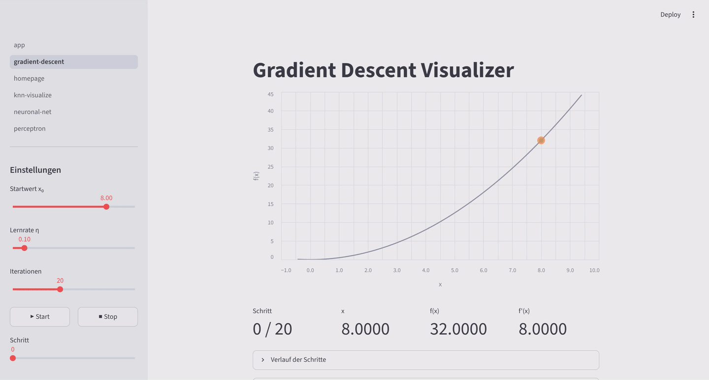
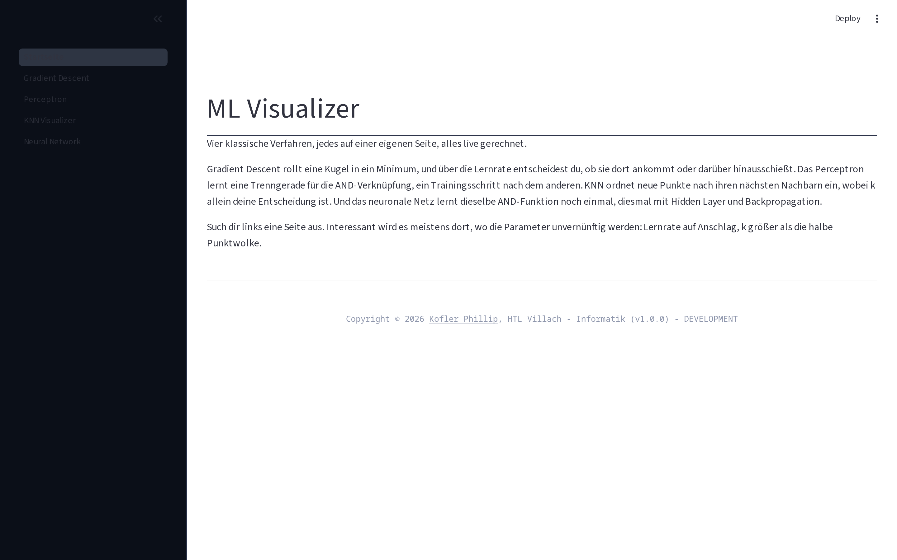
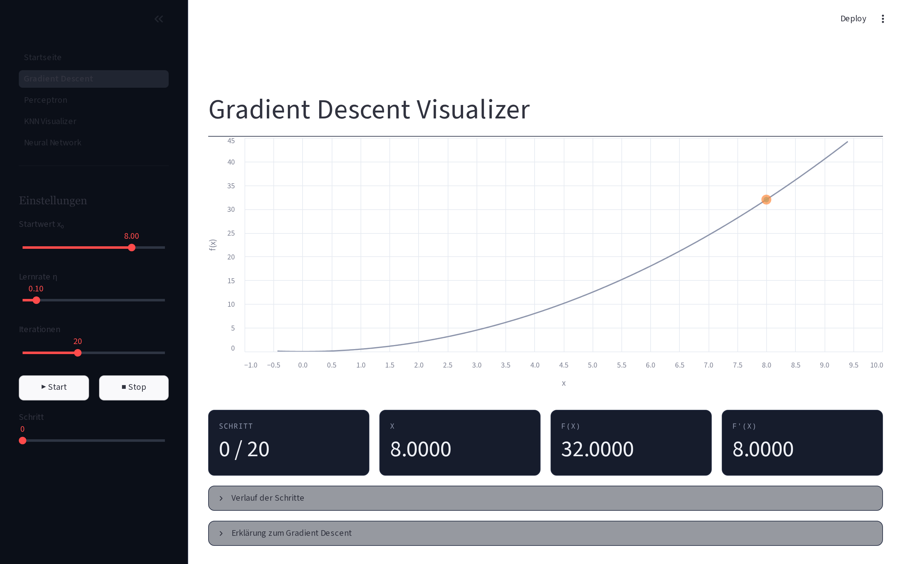
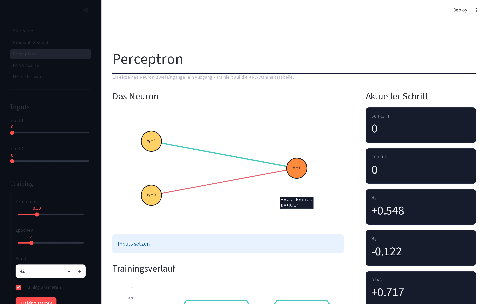
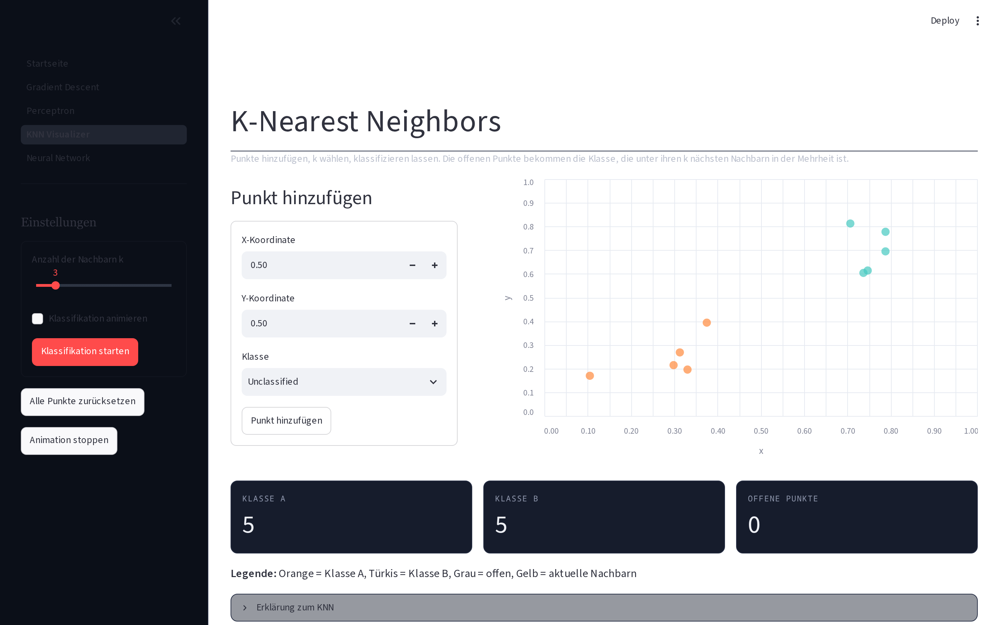
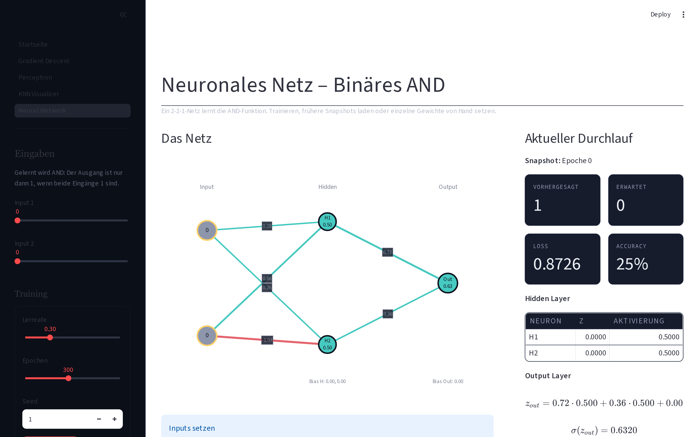

<div align="center">

# ML Visualizer

**Four classical machine learning algorithms, explained by watching them run.**
A Streamlit app where every plot is live: drag a slider and the gradient descent step, the perceptron weight or the KNN classification recomputes in front of you.

[](https://gitlab.com/WoofiOwO/ml-visualizer/-/commits/main)
[](./LICENSE)


</div>



<div align="center"><sub>Starting the Gradient Descent animation and watching it step down the curve.<br/>Also available as <a href="docs/demo/ml-visualizer-demo.mp4">full-resolution video</a> (60 fps).</sub></div>

## Features

### Home



- Landing page (in German, like the rest of the app) that explains in three short paragraphs what each of the four pages does and where it gets interesting to poke at — an unreasonable learning rate, a `k` larger than half the point cloud.

### Gradient Descent



- Minimizes `f(x) = 0.5x²` from a configurable start value, learning rate and iteration count, either step-by-step or animated with Start/Stop.
- The step history is memoized with `st.cache_data`, so replaying the same parameters (e.g. after switching tabs and back) does not recompute it.

### Perceptron



- A single neuron with two inputs, trained on the AND truth table, with the diagram, current weights, bias and epoch stepping through training live.
- Learning rate, epoch count and the random seed used to initialize the weights are all adjustable, so a run is reproducible.

### KNN Visualizer



- Add points by hand or start from a seeded two-cluster point cloud, pick `k`, and classify — unlabeled points take the majority class of their `k` nearest neighbors.

### Neural Network



- The same AND function as the perceptron page, this time with a hidden layer and backpropagation, showing every weight, the hidden-layer activations and the loss/accuracy curve per epoch.
- Snapshots per training epoch let you scrub back through a run instead of only ever seeing the final weights.

## Why it is built this way

- Every algorithm lives on its own `st.Page` (`src/pages/*.py`) registered in `src/app.py` — no shared page router to keep in sync, and a page can be added or removed without touching the others.
- Random seeds (perceptron init, the KNN starting cloud, the neural net's weight init) are fixed by default rather than reseeded per run, so a demo is reproducible instead of a different plot on every reload.
- The app runs on a Contabo VPS behind the shared Caddy reverse proxy, as two blue/green container slots, so a deploy only switches traffic once the new container reports healthy. Everything the VPS needs is versioned in `infrastructure/vps/`.

## Tech stack

| Layer         | Tech                                                     |
| ------------- | --------------------------------------------------------- |
| Application   | Python 3.12, Streamlit, NumPy, Pandas, Altair, Plotly     |
| Testing       | pytest, pytest-cov                                        |
| Code quality  | Ruff, Black, pre-commit                                   |
| Container     | Docker (multi-stage build), Docker Compose                |
| CI/CD         | GitLab CI                                                  |
| Hosting       | Contabo VPS (Docker Compose, Caddy), GitLab Container Registry |

## Getting started

```bash
python3 -m venv .venv
source .venv/bin/activate
pip install -r requirements.txt
streamlit run src/app.py
```

Visit <http://localhost:8501>.

Or with Docker:

```bash
docker compose -f docker/docker-compose.dev.yml up
```

Run the tests:

```bash
pip install -r requirements.txt
pytest src/tests/ -v --cov=src
```

## Project structure

```text
.
├── src/                          # Application source
│   ├── app.py                    # Entry point — registers the pages, renders the footer
│   ├── pages/                    # One file per algorithm (homepage, gradient-descent, perceptron, knn-visualize, neuronal-net)
│   ├── utils/                    # Config, versioning, theme colors, neural-network math
│   ├── styles/                   # Sidebar and page CSS
│   └── tests/                    # pytest suite (pages, algorithms, utils, integration)
├── docker/                       # Per-environment Compose files and the dev Dockerfile
├── infrastructure/vps/            # VPS side of the deploy: compose file, deploy.sh, Caddy block, preview config
├── landing/                       # Static marketing page served separately from the Streamlit app
├── organizational/                # Project-management notes (test plans, GitLab API scratch requests)
├── Dockerfile                     # Production image
├── .gitlab-ci.yml                 # Pipeline: validate → lint → test → security → build → deploy → release
└── requirements.txt
```

## CI/CD

`.gitlab-ci.yml` runs `validate → lint → test → security → build → deploy:review → deploy:production → release → pages`. Every merge request builds an image into the GitLab registry and can start a throwaway preview container on the VPS (manual `deploy-review` job, removed when the MR is merged or closed). A `v*` tag builds the release image; the manual `deploy-production` job then SSHes into the VPS, starts the idle slot, waits for Streamlit's health endpoint, flips Caddy to it and removes the old slot. A failed health check leaves the live slot untouched. GitLab's SAST and dependency-scanning templates run in the security stage. Setup and operations are in [`infrastructure/vps/README.md`](infrastructure/vps/README.md).

## License

MIT, see [LICENSE](./LICENSE).
